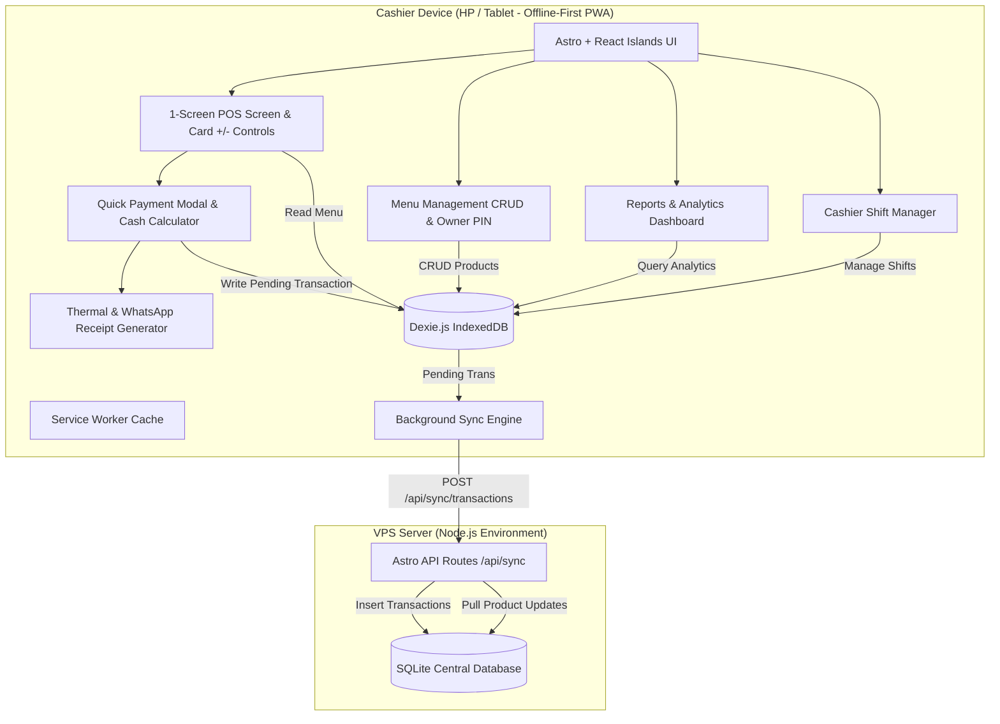

# Martabak Purnama POS Implementation Plan

> **For agentic workers:** REQUIRED SUB-SKILL: Use superpowers:subagent-driven-development to implement this plan task-by-task. Steps use checkbox (`- [ ]`) syntax for tracking.

**Goal:** Build a modern, offline-first Point of Sale (POS) Progressive Web App for "Martabak Purnama" using Astro.build with single-screen cashier transactions, preloaded authentic menu catalog, menu management dashboard, shift reconciliation, thermal receipt printing, and comprehensive sales reports synced to a VPS SQLite database.

**Architecture:** The application uses Astro in hybrid SSR mode with Node.js adapter on the VPS. The cashier UI is built with React Islands and Tailwind CSS, executing 100% offline-first against client-side IndexedDB (Dexie.js) for sub-5ms transaction speed without network dependency. When connectivity is available, an automatic background sync worker synchronizes transactions and menu catalogs to server-side SQLite on the VPS.

**Architecture Diagram:**



**Tech Stack:**
- **Framework**: Astro 5.x (Hybrid mode, Node.js adapter `@astrojs/node`)
- **UI & Islands**: React 19, Lucide React icons
- **Styling**: Tailwind CSS (warm golden amber `#F59E0B`/`#D97706` & slate palette)
- **Client DB**: Dexie.js (IndexedDB wrapper)
- **Server DB**: SQLite via `better-sqlite3`
- **PWA**: `@vite-pwa/astro` + Workbox
- **Receipts**: Web Bluetooth API (ESC/POS) + HTML Print Stylesheet + WhatsApp URL Schema
- **Testing**: Vitest for unit & integration testing

**Spec:** [docs/superpowers/specs/2026-10-29-martabak-pos-design.md](file:///c:/Users/Mallik/Documents/martabak/docs/superpowers/specs/2026-10-29-martabak-pos-design.md)

## Global Constraints

- Must work 100% offline without failing during checkout or menu browsing.
- 1-Screen Transaction: Counter buttons `+` / `-` must be directly on product cards without navigating away to a cart page.
- Touch target sizes must be at least 48px × 48px for quick, accurate cashier tapping.
- Owner PIN protection (4 digits, default `1234`) for Menu Management, Reports, and Shift Close.
- Preloaded menu must match the authentic "Martabak Purnama" menu card (Paseh: 085 724 770 052, Lengkong: 089 953 508 58).
- Thermal receipt formatting must support 58mm and 80mm roll widths with clear column alignments.

---

### Task 1: Project Initialization & Core Scaffolding

**Files:**
- Create: `package.json`
- Create: `astro.config.mjs`
- Create: `tsconfig.json`
- Create: `tailwind.config.mjs`
- Create: `src/layouts/Layout.astro`
- Create: `src/pages/index.astro`
- Create: `src/styles/global.css`
- Test: `tests/scaffold.test.ts`

**Interfaces:**
- Produces: Base Astro project with React, Tailwind CSS, Node adapter, and responsive viewport configuration.

- [ ] **Step 1: Write the scaffold test**
Create `tests/scaffold.test.ts` to test project configuration validity:
```typescript
import { describe, it, expect } from 'vitest';
import fs from 'node:fs';

describe('Project Scaffolding', () => {
  it('has package.json with astro and react dependencies', () => {
    const pkg = JSON.parse(fs.readFileSync('package.json', 'utf-8'));
    expect(pkg.dependencies.astro).toBeDefined();
    expect(pkg.dependencies['@astrojs/react']).toBeDefined();
    expect(pkg.dependencies['dexie']).toBeDefined();
  });
});
```

- [ ] **Step 2: Run test to verify it fails**
Run: `npx vitest run tests/scaffold.test.ts`
Expected: FAIL (package.json not yet created or missing dependencies).

- [ ] **Step 3: Setup project dependencies and configuration**
Create `package.json`:
```json
{
  "name": "martabak-pos",
  "type": "module",
  "version": "1.0.0",
  "scripts": {
    "dev": "astro dev --host",
    "start": "astro dev",
    "build": "astro build",
    "preview": "astro preview",
    "astro": "astro",
    "test": "vitest run"
  },
  "dependencies": {
    "@astrojs/node": "^9.0.0",
    "@astrojs/react": "^4.2.0",
    "@astrojs/tailwind": "^5.1.5",
    "astro": "^5.3.0",
    "better-sqlite3": "^11.8.1",
    "canvas-confetti": "^1.9.4",
    "dexie": "^4.0.11",
    "lucide-react": "^1.16.0",
    "react": "^19.0.0",
    "react-dom": "^19.0.0",
    "tailwindcss": "^3.4.17"
  },
  "devDependencies": {
    "@types/better-sqlite3": "^7.6.12",
    "@types/canvas-confetti": "^1.9.0",
    "@types/node": "^22.13.0",
    "@types/react": "^19.0.0",
    "@types/react-dom": "^19.0.0",
    "typescript": "^5.7.3",
    "vitest": "^3.0.5"
  }
}
```
Create `astro.config.mjs`:
```javascript
import { defineConfig } from 'astro/config';
import react from '@astrojs/react';
import tailwind from '@astrojs/tailwind';
import node from '@astrojs/node';

export default defineConfig({
  output: 'server',
  adapter: node({
    mode: 'standalone',
  }),
  integrations: [
    react(),
    tailwind({
      applyBaseStyles: false,
    }),
  ],
  vite: {
    ssr: {
      noExternal: ['lucide-react'],
    },
  },
});
```
Create `tailwind.config.mjs`:
```javascript
/** @type {import('tailwindcss').Config} */
export default {
  content: ['./src/**/*.{astro,html,js,jsx,md,mdx,svelte,ts,tsx,vue}'],
  darkMode: 'class',
  theme: {
    extend: {
      colors: {
        brand: {
          50: '#fffbeb',
          100: '#fef3c7',
          200: '#fde68a',
          300: '#fcd34d',
          400: '#fbbf24',
          500: '#f59e0b',
          600: '#d97706',
          700: '#b45309',
          800: '#92400e',
          900: '#78350f',
        },
      },
    },
  },
  plugins: [],
};
```
Create `src/styles/global.css`:
```css
@tailwind base;
@tailwind components;
@tailwind utilities;

@layer base {
  body {
    @apply bg-slate-950 text-slate-100 antialiased font-sans select-none;
    -webkit-tap-highlight-color: transparent;
  }
}

/* Print thermal styling */
@media print {
  body * {
    visibility: hidden;
  }
  #thermal-receipt-print, #thermal-receipt-print * {
    visibility: visible;
  }
  #thermal-receipt-print {
    position: absolute;
    left: 0;
    top: 0;
    width: 58mm;
    margin: 0;
    padding: 2mm;
    font-size: 11px;
    font-family: monospace;
    color: black;
    background: white;
  }
}
```
Create `src/layouts/Layout.astro` and `src/pages/index.astro`.

- [ ] **Step 4: Run test to verify it passes**
Run: `npm install && npx vitest run tests/scaffold.test.ts`
Expected: PASS.

- [ ] **Step 5: Commit**
```bash
git add package.json astro.config.mjs tailwind.config.mjs tsconfig.json src/ tests/
git commit -m "chore: scaffold Astro project with React, Tailwind, and Node adapter"
```

---

### Task 2: Data Models & Offline-First Storage Layer (Dexie.js + SQLite)

**Files:**
- Create: `src/types/pos.ts`
- Create: `src/lib/initialMenu.ts`
- Create: `src/lib/clientDb.ts`
- Create: `src/lib/serverDb.ts`
- Test: `tests/db.test.ts`

**Interfaces:**
- Produces:
  - `Product`, `Transaction`, `CartItem`, `Shift`, `StoreSettings` types
  - `clientDb` Dexie database instance with initial seed data loader
  - `getServerDb()` SQLite instance with central schema initialization

- [ ] **Step 1: Write failing database unit tests**
Create `tests/db.test.ts`:
```typescript
import { describe, it, expect, beforeEach } from 'vitest';
import { initialProducts } from '../src/lib/initialMenu';

describe('Data Models & Initial Menu', () => {
  it('contains all 20 Martabak Manis items', () => {
    const manis = initialProducts.filter(p => p.category === 'manis');
    expect(manis.length).toBe(20);
    const keju = manis.find(p => p.name === 'Keju');
    expect(keju?.price).toBe(25000);
    const doubleCheese = manis.find(p => p.name === 'Double Cheese');
    expect(doubleCheese?.price).toBe(40000);
  });

  it('contains all 19 Tipis Kering items', () => {
    const tipis = initialProducts.filter(p => p.category === 'tipis_kering');
    expect(tipis.length).toBe(19);
  });

  it('contains Martabak Asin items with Biasa, Spesial, and Super tiers', () => {
    const ayam = initialProducts.filter(p => p.category === 'asin_ayam');
    const centil = ayam.find(p => p.name === 'Ayam Centil');
    expect(centil).toBeDefined();
    expect(centil?.variantPrices?.biasa).toBe(25000);
    expect(centil?.variantPrices?.spesial).toBe(30000);
    expect(centil?.variantPrices?.super).toBe(35000);
  });
});
```

- [ ] **Step 2: Run test to verify it fails**
Run: `npx vitest run tests/db.test.ts`
Expected: FAIL (files not yet created).

- [ ] **Step 3: Implement data models and preloaded menu catalog**
Create `src/types/pos.ts`:
```typescript
export type ProductCategory = 'manis' | 'tipis_kering' | 'asin_ayam' | 'asin_sapi' | 'ekstra';

export type AsinTier = 'biasa' | 'spesial' | 'super';

export interface Product {
  id: string;
  name: string;
  category: ProductCategory;
  price: number;
  hasVariants?: boolean;
  variantPrices?: {
    biasa?: number;
    spesial?: number;
    super?: number;
  };
  isAvailable: boolean;
  updatedAt: number;
}

export interface CartItem {
  id: string; // unique cart entry key: `${productId}-${tier || 'std'}-${note}`
  productId: string;
  name: string;
  category: ProductCategory;
  tier?: AsinTier;
  price: number;
  qty: number;
  note?: string;
  subtotal: number;
}

export interface Transaction {
  id: string;
  invoiceNo: string;
  createdAt: number;
  items: CartItem[];
  totalAmount: number;
  paymentMethod: 'cash' | 'qris';
  cashTendered?: number;
  changeAmount?: number;
  customerPhone?: string;
  shiftId?: string;
  syncStatus: 'pending' | 'synced';
  syncedAt?: number;
}

export interface Shift {
  id: string;
  cashierName: string;
  startTime: number;
  endTime?: number;
  initialCash: number;
  totalCashSales: number;
  totalQrisSales: number;
  actualCash?: number;
  difference?: number;
  status: 'open' | 'closed';
  createdAt: number;
}

export interface StoreSettings {
  storeName: string;
  tagline: string;
  contactPaseh: string;
  contactLengkong: string;
  instagram: string;
  facebook: string;
  ownerPinHash: string;
  paperWidth: '58mm' | '80mm';
}
```
Create `src/lib/initialMenu.ts` with all 20 Martabak Manis, 19 Tipis Kering, and all Ayam/Sapi Asin items matching the user's menu photo.
Create `src/lib/clientDb.ts` configuring Dexie:
```typescript
import Dexie, { type EntityTable } from 'dexie';
import type { Product, Transaction, Shift, StoreSettings } from '../types/pos';
import { initialProducts, defaultSettings } from './initialMenu';

export class PosDatabase extends Dexie {
  products!: EntityTable<Product, 'id'>;
  transactions!: EntityTable<Transaction, 'id'>;
  shifts!: EntityTable<Shift, 'id'>;
  settings!: EntityTable<{ key: string; value: any }, 'key'>;

  constructor() {
    super('MartabakPurnamaDB');
    this.version(1).stores({
      products: 'id, name, category, isAvailable, updatedAt',
      transactions: 'id, invoiceNo, createdAt, syncStatus, shiftId',
      shifts: 'id, status, startTime',
      settings: 'key',
    });
  }

  async seedDefaultsIfEmpty() {
    const count = await this.products.count();
    if (count === 0) {
      await this.products.bulkAdd(initialProducts);
      for (const [key, val] of Object.entries(defaultSettings)) {
        await this.settings.put({ key, value: val });
      }
    }
  }
}

export const db = new PosDatabase();
```
Create `src/lib/serverDb.ts` setting up central SQLite schema for VPS syncing.

- [ ] **Step 4: Run test to verify it passes**
Run: `npx vitest run tests/db.test.ts`
Expected: PASS.

- [ ] **Step 5: Commit**
```bash
git add src/types/pos.ts src/lib/initialMenu.ts src/lib/clientDb.ts src/lib/serverDb.ts tests/db.test.ts
git commit -m "feat: implement data models, preloaded menu catalog, and client/server database schemas"
```

---

### Task 3: 1-Screen POS Counter Interface (Menu Grid & Responsive Islands)

**Files:**
- Create: `src/components/pos/HeaderBar.tsx`
- Create: `src/components/pos/CategoryTabs.tsx`
- Create: `src/components/pos/ProductCard.tsx`
- Create: `src/components/pos/VariantModal.tsx`
- Create: `src/components/pos/StickyBottomBar.tsx`
- Create: `src/components/pos/PosScreen.tsx`
- Test: `tests/pos-cart.test.ts`

**Interfaces:**
- Consumes: `Product`, `CartItem` from `src/types/pos.ts`
- Produces: `PosScreen` React component mounted in `src/pages/index.astro` supporting instant 1-screen additions/decrements.

- [ ] **Step 1: Write cart state calculation tests**
Create `tests/pos-cart.test.ts`:
```typescript
import { describe, it, expect } from 'vitest';
import type { CartItem } from '../src/types/pos';

function calculateCartTotals(items: CartItem[]) {
  const totalQty = items.reduce((sum, item) => sum + item.qty, 0);
  const totalAmount = items.reduce((sum, item) => sum + item.subtotal, 0);
  return { totalQty, totalAmount };
}

describe('Cart Calculations', () => {
  it('correctly aggregates quantity and subtotal', () => {
    const items: CartItem[] = [
      { id: '1', productId: 'p1', name: 'Keju', category: 'manis', price: 25000, qty: 2, subtotal: 50000 },
      { id: '2', productId: 'p2', name: 'Ayam Centil', category: 'asin_ayam', tier: 'spesial', price: 30000, qty: 1, subtotal: 30000 },
    ];
    const { totalQty, totalAmount } = calculateCartTotals(items);
    expect(totalQty).toBe(3);
    expect(totalAmount).toBe(80000);
  });
});
```

- [ ] **Step 2: Run test to verify it passes**
Run: `npx vitest run tests/pos-cart.test.ts`
Expected: PASS.

- [ ] **Step 3: Implement 1-Screen POS components**
Create `ProductCard.tsx`:
- Render product name, category badge, and formatted price.
- If `qty === 0`: render large button `+ Tambah` (min 48px height).
- If `qty > 0`: render amber counter `[-]  qty  [+]` with click handlers directly updating cart.
- For items with variants (Martabak Asin) or custom notes: provide quick option button `⚡ Opsi` to open `VariantModal.tsx`.

Create `VariantModal.tsx`:
- Quick tier selector: `Biasa`, `Spesial`, `Super` with their specific prices.
- Quick note tags: `Garing`, `Setengah Matang`, `Pedas`, `Sedang`, `Jangan Gosong`.
- One-tap "Tambah ke Pesanan" closing instantly without full page navigation.

Create `StickyBottomBar.tsx`:
- Fixed floating bar on mobile bottom displaying:
  - Total item count badge
  - Total Rupiah in large bold text (`Rp XX.000`)
  - Big prominent `Bayar Sekarang` green action button.
- In tablet layout (CSS `md:hidden` / `md:flex` split), renders sticky right sidebar with full order details.

Create `PosScreen.tsx` orchestrating header, category filters, product grid, and bottom bar.

- [ ] **Step 4: Connect to index.astro and verify UI**
Mount `<PosScreen client:only="react" />` in `src/pages/index.astro`.
Run: `npm run build`
Expected: Build succeeds with 0 errors.

- [ ] **Step 5: Commit**
```bash
git add src/components/pos/ src/pages/index.astro tests/pos-cart.test.ts
git commit -m "feat: implement 1-screen transaction POS interface with direct card increment controls"
```

---

### Task 4: Quick Payment Flow & Auto-Change Calculator

**Files:**
- Create: `src/components/pos/PaymentModal.tsx`
- Create: `src/lib/invoice.ts`
- Test: `tests/payment.test.ts`

**Interfaces:**
- Consumes: Cart state from `PosScreen`
- Produces: Completed `Transaction` saved to `clientDb.transactions` with `syncStatus: 'pending'`.

- [ ] **Step 1: Write invoice generator & change calculator tests**
Create `tests/payment.test.ts`:
```typescript
import { describe, it, expect } from 'vitest';
import { generateInvoiceNumber, calculateChange, getQuickCashSuggestions } from '../src/lib/invoice';

describe('Payment & Invoice Utilities', () => {
  it('generates format MP-YYYYMMDD-XXXX', () => {
    const inv = generateInvoiceNumber(1);
    expect(inv).toMatch(/^MP-\d{8}-0001$/);
  });

  it('calculates correct cash change', () => {
    expect(calculateChange(85000, 100000)).toBe(15000);
    expect(calculateChange(85000, 85000)).toBe(0);
    expect(calculateChange(85000, 50000)).toBe(-35000); // underpaid
  });

  it('provides sensible cash denomination shortcuts', () => {
    const shortcuts = getQuickCashSuggestions(77000);
    expect(shortcuts).toContain(77000); // Uang Pas
    expect(shortcuts).toContain(80000); // Next 10k
    expect(shortcuts).toContain(100000); // Next 50k/100k
  });
});
```

- [ ] **Step 2: Run test to verify it fails**
Run: `npx vitest run tests/payment.test.ts`
Expected: FAIL (`generateInvoiceNumber` not defined).

- [ ] **Step 3: Implement invoice & payment modal**
Create `src/lib/invoice.ts`:
```typescript
export function generateInvoiceNumber(seq: number): string {
  const d = new Date();
  const yyyy = d.getFullYear();
  const mm = String(d.getMonth() + 1).padStart(2, '0');
  const dd = String(d.getDate()).padStart(2, '0');
  const padSeq = String(seq).padStart(4, '0');
  return `MP-${yyyy}${mm}${dd}-${padSeq}`;
}

export function calculateChange(total: number, tendered: number): number {
  return tendered - total;
}

export function getQuickCashSuggestions(total: number): number[] {
  const suggestions = new Set<number>();
  suggestions.add(total); // Uang Pas
  const next10k = Math.ceil(total / 10000) * 10000;
  if (next10k > total) suggestions.add(next10k);
  const next50k = Math.ceil(total / 50000) * 50000;
  if (next50k > total) suggestions.add(next50k);
  const next100k = Math.ceil(total / 100000) * 100000;
  if (next100k > total) suggestions.add(next100k);
  return Array.from(suggestions).slice(0, 4);
}
```
Create `PaymentModal.tsx`:
- Render total tagihan in huge text.
- Tabs: `[ 💵 Tunai ]` and `[ 📱 QRIS ]`.
- Cash mode:
  - Display quick cash suggestion buttons.
  - Custom cash input with quick numpad.
  - Large auto-change banner (e.g. `Kembalian: Rp 23.000`).
  - Disable "Selesaikan Transaksi" if cash tendered < total amount.
- QRIS mode:
  - Display static QRIS store mockup/code.
  - "Konfirmasi Diterima" button.
- Optional customer phone input for WhatsApp receipt.
- Save transaction to `db.transactions.add(...)` with `syncStatus: 'pending'`.
- Trigger celebratory visual effect (`canvas-confetti`) and transition to receipt modal.

- [ ] **Step 4: Run test to verify it passes**
Run: `npx vitest run tests/payment.test.ts`
Expected: PASS.

- [ ] **Step 5: Commit**
```bash
git add src/lib/invoice.ts src/components/pos/PaymentModal.tsx tests/payment.test.ts
git commit -m "feat: implement payment flow with quick cash shortcuts, auto-change, and QRIS support"
```

---

### Task 5: Thermal Receipt & WhatsApp Digital Receipt

**Files:**
- Create: `src/lib/receipt.ts`
- Create: `src/components/pos/ReceiptModal.tsx`
- Test: `tests/receipt.test.ts`

**Interfaces:**
- Consumes: `Transaction`, `StoreSettings`
- Produces:
  - Clean ESC/POS formatted byte commands for 58mm/80mm Bluetooth printers
  - Formatted WhatsApp text string and web URL
  - Printable HTML thermal receipt component

- [ ] **Step 1: Write receipt formatting tests**
Create `tests/receipt.test.ts`:
```typescript
import { describe, it, expect } from 'vitest';
import { formatWhatsAppReceipt, formatReceiptText } from '../src/lib/receipt';
import type { Transaction } from '../src/types/pos';

describe('Receipt Formatting', () => {
  const sampleTx: Transaction = {
    id: 'tx1',
    invoiceNo: 'MP-20261029-0001',
    createdAt: 1793280000000,
    items: [
      { id: '1', productId: 'p1', name: 'Keju Coklat', category: 'manis', price: 25000, qty: 1, subtotal: 25000 },
      { id: '2', productId: 'p2', name: 'Ayam Spesial', category: 'asin_ayam', tier: 'spesial', price: 30000, qty: 1, subtotal: 30000 },
    ],
    totalAmount: 55000,
    paymentMethod: 'cash',
    cashTendered: 60000,
    changeAmount: 5000,
    syncStatus: 'pending',
  };

  it('formats clean WhatsApp message with store header and items', () => {
    const waText = formatWhatsAppReceipt(sampleTx, '085724770052');
    expect(waText).toContain('MARTABAK PURNAMA');
    expect(waText).toContain('MP-20261029-0001');
    expect(waText).toContain('Keju Coklat');
    expect(waText).toContain('Rp 55.000');
  });

  it('formats 32-column text for 58mm thermal paper', () => {
    const receipt = formatReceiptText(sampleTx, 32);
    expect(receipt).toContain('MARTABAK PURNAMA');
    expect(receipt).toContain('TOTAL');
  });
});
```

- [ ] **Step 2: Run test to verify it fails**
Run: `npx vitest run tests/receipt.test.ts`
Expected: FAIL (`formatWhatsAppReceipt` not defined).

- [ ] **Step 3: Implement receipt generator & modal**
Create `src/lib/receipt.ts`:
- Implement `formatReceiptText(tx, columns)` with exact 32-column (58mm) and 48-column (80mm) alignments.
- Implement `formatWhatsAppReceipt(tx, phone)` returning `https://wa.me/{cleanPhone}?text={encodedText}`.
- Implement `printViaWebBluetooth(receiptBytes)` using `navigator.bluetooth.requestDevice`.
- Implement `printViaBrowserDialog()`.

Create `ReceiptModal.tsx`:
- Show visual thermal receipt preview with perforated paper look.
- Action buttons:
  - `[ 🖨️ Cetak Struk Bluetooth ]`
  - `[ 📄 Cetak Browser (58/80mm) ]`
  - `[ 💬 Kirim Struk WhatsApp ]`
  - `[ ➡️ Pesanan Baru ]` (resets cart in 0 seconds).

- [ ] **Step 4: Run test to verify it passes**
Run: `npx vitest run tests/receipt.test.ts`
Expected: PASS.

- [ ] **Step 5: Commit**
```bash
git add src/lib/receipt.ts src/components/pos/ReceiptModal.tsx tests/receipt.test.ts
git commit -m "feat: implement 58mm/80mm thermal receipt and WhatsApp digital receipt engine"
```

---

### Task 6: Cashier Shift Management (Buka & Tutup Shift)

**Files:**
- Create: `src/lib/shift.ts`
- Create: `src/components/pos/ShiftModal.tsx`
- Test: `tests/shift.test.ts`

**Interfaces:**
- Consumes: `clientDb.shifts`, `clientDb.transactions`
- Produces: Shift reconciliation functions & Shift Modal UI.

- [ ] **Step 1: Write shift calculation tests**
Create `tests/shift.test.ts`:
```typescript
import { describe, it, expect } from 'vitest';
import { calculateShiftSummary } from '../src/lib/shift';
import type { Transaction } from '../src/types/pos';

describe('Shift Management', () => {
  it('correctly calculates total cash, QRIS, and drawer discrepancy', () => {
    const txs: Transaction[] = [
      { id: '1', invoiceNo: '1', createdAt: 1, items: [], totalAmount: 50000, paymentMethod: 'cash', syncStatus: 'pending' },
      { id: '2', invoiceNo: '2', createdAt: 2, items: [], totalAmount: 30000, paymentMethod: 'cash', syncStatus: 'pending' },
      { id: '3', invoiceNo: '3', createdAt: 3, items: [], totalAmount: 40000, paymentMethod: 'qris', syncStatus: 'pending' },
    ];
    const initialCash = 100000;
    const actualCash = 180000; // 100k + 80k cash sales
    const summary = calculateShiftSummary(initialCash, txs, actualCash);

    expect(summary.totalCashSales).toBe(80000);
    expect(summary.totalQrisSales).toBe(40000);
    expect(summary.expectedCash).toBe(180000);
    expect(summary.difference).toBe(0);
  });
});
```

- [ ] **Step 2: Run test to verify it fails**
Run: `npx vitest run tests/shift.test.ts`
Expected: FAIL (`calculateShiftSummary` not defined).

- [ ] **Step 3: Implement shift logic & ShiftModal component**
Create `src/lib/shift.ts`:
- `calculateShiftSummary(initialCash, transactions, actualCash)`
- `openNewShift(cashierName, initialCash)`
- `closeCurrentShift(shiftId, actualCash)`

Create `ShiftModal.tsx`:
- If no active shift: form to start shift (Cashier name + Modal Awal, e.g. Rp 100.000).
- If active shift: view current shift statistics (Sales, Cash, QRIS) + "Tutup Shift" action with PIN confirmation.
- Option to print shift closing summary on thermal printer.

- [ ] **Step 4: Run test to verify it passes**
Run: `npx vitest run tests/shift.test.ts`
Expected: PASS.

- [ ] **Step 5: Commit**
```bash
git add src/lib/shift.ts src/components/pos/ShiftModal.tsx tests/shift.test.ts
git commit -m "feat: implement cashier shift management and drawer reconciliation"
```

---

### Task 7: Menu Management Dashboard (CRUD Menu with PIN Gate)

**Files:**
- Create: `src/components/auth/PinModal.tsx`
- Create: `src/components/menu/MenuManager.tsx`
- Create: `src/components/menu/ProductFormModal.tsx`
- Test: `tests/menu-crud.test.ts`

**Interfaces:**
- Consumes: `clientDb.products`, `clientDb.settings`
- Produces: Owner Menu Dashboard for adding, editing prices, toggling availability, and archiving products.

- [ ] **Step 1: Write PIN verification & product validation tests**
Create `tests/menu-crud.test.ts`:
```typescript
import { describe, it, expect } from 'vitest';
import { verifyOwnerPin, validateProductPayload } from '../src/lib/auth';

describe('Menu Management & PIN Auth', () => {
  it('validates default PIN 1234', () => {
    expect(verifyOwnerPin('1234', '1234')).toBe(true);
    expect(verifyOwnerPin('0000', '1234')).toBe(false);
  });

  it('validates required product fields', () => {
    const valid = validateProductPayload({ name: 'Martabak Durian', category: 'manis', price: 35000 });
    expect(valid.isValid).toBe(true);

    const invalid = validateProductPayload({ name: '', category: 'manis', price: -5000 });
    expect(invalid.isValid).toBe(false);
  });
});
```

- [ ] **Step 2: Run test to verify it fails**
Run: `npx vitest run tests/menu-crud.test.ts`
Expected: FAIL (`verifyOwnerPin` not defined).

- [ ] **Step 3: Implement PIN Modal & Menu Management UI**
Create `src/lib/auth.ts`:
- Implement `verifyOwnerPin(inputPin, storedPin)` and `validateProductPayload(product)`.

Create `PinModal.tsx`:
- 4-digit PIN numpad modal with masked dots `● ● ● ●`.
- Shake animation on incorrect PIN.

Create `ProductFormModal.tsx`:
- Add/Edit product form:
  - Name, Category dropdown (`manis`, `tipis_kering`, `asin_ayam`, `asin_sapi`, `ekstra`).
  - Single Price input OR Multi-tier inputs (`Biasa`, `Spesial`, `Super`).
  - Is Available switch.

Create `MenuManager.tsx`:
- Search bar & category tabs.
- Table/Grid of all items with instant Availability toggle (`Tersedia` / `Habis`).
- `Edit` and `Hapus` actions updating IndexedDB and marking `updatedAt: Date.now()`.
- "Tambah Menu Baru" button.

- [ ] **Step 4: Run test to verify it passes**
Run: `npx vitest run tests/menu-crud.test.ts`
Expected: PASS.

- [ ] **Step 5: Commit**
```bash
git add src/lib/auth.ts src/components/auth/PinModal.tsx src/components/menu/ tests/menu-crud.test.ts
git commit -m "feat: implement menu management dashboard with 4-digit PIN security"
```

---

### Task 8: Sales Reports & Owner Analytics Dashboard

**Files:**
- Create: `src/lib/analytics.ts`
- Create: `src/components/reports/ReportsDashboard.tsx`
- Create: `src/components/reports/TransactionHistoryTable.tsx`
- Test: `tests/reports.test.ts`

**Interfaces:**
- Consumes: `clientDb.transactions`
- Produces: Executive KPI metrics, date filtering, Best Seller rankings, and CSV export.

- [ ] **Step 1: Write analytics aggregation tests**
Create `tests/reports.test.ts`:
```typescript
import { describe, it, expect } from 'vitest';
import { aggregateSalesMetrics, getTopSellingProducts, exportTransactionsToCsv } from '../src/lib/analytics';
import type { Transaction } from '../src/types/pos';

describe('Reports Analytics', () => {
  const sampleTxs: Transaction[] = [
    {
      id: '1', invoiceNo: 'MP-01', createdAt: 1000,
      items: [{ id: '1', productId: 'p1', name: 'Keju Coklat', category: 'manis', price: 25000, qty: 3, subtotal: 75000 }],
      totalAmount: 75000, paymentMethod: 'cash', syncStatus: 'pending'
    },
    {
      id: '2', invoiceNo: 'MP-02', createdAt: 2000,
      items: [
        { id: '1', productId: 'p1', name: 'Keju Coklat', category: 'manis', price: 25000, qty: 1, subtotal: 25000 },
        { id: '2', productId: 'p2', name: 'Ayam Spesial', category: 'asin_ayam', price: 30000, qty: 2, subtotal: 60000 },
      ],
      totalAmount: 85000, paymentMethod: 'qris', syncStatus: 'pending'
    },
  ];

  it('aggregates total sales, transaction counts, and payment split', () => {
    const summary = aggregateSalesMetrics(sampleTxs);
    expect(summary.totalRevenue).toBe(160000);
    expect(summary.transactionCount).toBe(2);
    expect(summary.cashRevenue).toBe(75000);
    expect(summary.qrisRevenue).toBe(85000);
  });

  it('ranks top selling products by quantity', () => {
    const top = getTopSellingProducts(sampleTxs);
    expect(top[0].name).toBe('Keju Coklat');
    expect(top[0].totalQty).toBe(4);
  });

  it('generates valid CSV string with headers', () => {
    const csv = exportTransactionsToCsv(sampleTxs);
    expect(csv).toContain('Invoice,Tanggal,Total,Metode,StatusSync');
    expect(csv).toContain('MP-01');
  });
});
```

- [ ] **Step 2: Run test to verify it fails**
Run: `npx vitest run tests/reports.test.ts`
Expected: FAIL (`aggregateSalesMetrics` not defined).

- [ ] **Step 3: Implement analytics calculations & reports UI**
Create `src/lib/analytics.ts`:
- `aggregateSalesMetrics(transactions)`
- `getTopSellingProducts(transactions, limit = 5)`
- `exportTransactionsToCsv(transactions)`
- `filterTransactionsByRange(transactions, range: 'today' | '7days' | 'month' | 'all')`

Create `TransactionHistoryTable.tsx`:
- List of transactions with search by invoice number.
- Item detail modal with reprint receipt button.

Create `ReportsDashboard.tsx`:
- KPI Cards: Total Omset, Total Transaksi, Rata-rata Nilai Transaksi, % Tunai vs % QRIS.
- Date Range filter buttons: `Hari Ini`, `7 Hari`, `Bulan Ini`, `Semua`.
- Best Seller Ranking list with visual quantity progress bars.
- "📥 Unduh Laporan (CSV / Excel)" action button.

- [ ] **Step 4: Run test to verify it passes**
Run: `npx vitest run tests/reports.test.ts`
Expected: PASS.

- [ ] **Step 5: Commit**
```bash
git add src/lib/analytics.ts src/components/reports/ tests/reports.test.ts
git commit -m "feat: implement sales reports, KPI metrics, best seller analytics, and CSV export"
```

---

### Task 9: Background Sync API, Service Worker & PWA Setup

**Files:**
- Create: `src/pages/api/sync/transactions.ts`
- Create: `src/pages/api/sync/products.ts`
- Create: `src/lib/syncWorker.ts`
- Create: `public/manifest.json`
- Create: `public/sw.js`
- Test: `tests/sync.test.ts`

**Interfaces:**
- Produces: Astro server endpoints for SQLite VPS sync + client background sync worker.

- [ ] **Step 1: Write sync protocol tests**
Create `tests/sync.test.ts`:
```typescript
import { describe, it, expect } from 'vitest';
import { prepareSyncBatch, markTransactionsAsSynced } from '../src/lib/syncWorker';
import type { Transaction } from '../src/types/pos';

describe('Background Sync Protocol', () => {
  it('selects only pending transactions for batch push', () => {
    const txs: Transaction[] = [
      { id: '1', invoiceNo: '1', createdAt: 1, items: [], totalAmount: 10000, paymentMethod: 'cash', syncStatus: 'synced' },
      { id: '2', invoiceNo: '2', createdAt: 2, items: [], totalAmount: 20000, paymentMethod: 'cash', syncStatus: 'pending' },
    ];
    const batch = prepareSyncBatch(txs);
    expect(batch.length).toBe(1);
    expect(batch[0].id).toBe('2');
  });

  it('updates transactions to synced status', () => {
    const tx: Transaction = { id: '2', invoiceNo: '2', createdAt: 2, items: [], totalAmount: 20000, paymentMethod: 'cash', syncStatus: 'pending' };
    const updated = markTransactionsAsSynced([tx], ['2']);
    expect(updated[0].syncStatus).toBe('synced');
    expect(updated[0].syncedAt).toBeDefined();
  });
});
```

- [ ] **Step 2: Run test to verify it fails**
Run: `npx vitest run tests/sync.test.ts`
Expected: FAIL (`prepareSyncBatch` not defined).

- [ ] **Step 3: Implement sync endpoints and service worker**
Create `src/lib/syncWorker.ts`:
- Client sync worker listening to `window.addEventListener('online', ...)`.
- Automatic push of pending transactions to `/api/sync/transactions`.
- Pull of updated products from `/api/sync/products`.

Create `src/pages/api/sync/transactions.ts`:
- Server API route receiving JSON array of transactions.
- Writes transactions into server SQLite using `better-sqlite3`.
- Returns `{ success: true, syncedIds: string[] }`.

Create `src/pages/api/sync/products.ts`:
- Pull latest products from VPS SQLite.

Create `public/manifest.json`:
- `name: "Martabak Purnama POS"`, `short_name: "Purnama POS"`, `theme_color: "#D97706"`, `background_color: "#0F172A"`, `display: "standalone"`.

Create `public/sw.js` with offline caching strategy for app shell and assets.

- [ ] **Step 4: Run test to verify it passes**
Run: `npx vitest run tests/sync.test.ts`
Expected: PASS.

- [ ] **Step 5: Commit**
```bash
git add src/lib/syncWorker.ts src/pages/api/sync/ public/manifest.json public/sw.js tests/sync.test.ts
git commit -m "feat: implement background sync engine, VPS API endpoints, and PWA service worker"
```

---

### Task 10: System Integration, Polish & VPS Deployment Documentation

**Files:**
- Create: `deploy/Dockerfile`
- Create: `deploy/ecosystem.config.cjs`
- Create: `deploy/vps-setup.md`
- Create: `README.md`
- Modify: `src/pages/index.astro`
- Test: `tests/e2e-simulation.test.ts`

**Interfaces:**
- Produces: Complete end-to-end integrated application with verified production build and step-by-step VPS deployment guide.

- [ ] **Step 1: Write end-to-end integration simulation test**
Create `tests/e2e-simulation.test.ts`:
```typescript
import { describe, it, expect } from 'vitest';
import { initialProducts } from '../src/lib/initialMenu';
import { generateInvoiceNumber, calculateChange } from '../src/lib/invoice';
import { formatReceiptText } from '../src/lib/receipt';
import { aggregateSalesMetrics } from '../src/lib/analytics';
import type { CartItem, Transaction } from '../src/types/pos';

describe('End-to-End POS Cycle Simulation', () => {
  it('executes complete sale: select item -> calculate -> pay -> receipt -> report', () => {
    // 1. Pick Martabak Manis Keju (Rp 25.000) & Martabak Asin Ayam Spesial (Rp 30.000)
    const p1 = initialProducts.find(p => p.name === 'Keju')!;
    const p2 = initialProducts.find(p => p.name === 'Ayam Centil')!;

    const cart: CartItem[] = [
      { id: '1', productId: p1.id, name: p1.name, category: p1.category, price: p1.price, qty: 1, subtotal: 25000 },
      { id: '2', productId: p2.id, name: p2.name, category: p2.category, tier: 'spesial', price: 30000, qty: 1, subtotal: 30000 },
    ];

    const total = cart.reduce((s, i) => s + i.subtotal, 0);
    expect(total).toBe(55000);

    // 2. Pay cash Rp 100.000
    const change = calculateChange(total, 100000);
    expect(change).toBe(45000);

    // 3. Generate transaction
    const tx: Transaction = {
      id: 'tx-test-1',
      invoiceNo: generateInvoiceNumber(1),
      createdAt: Date.now(),
      items: cart,
      totalAmount: total,
      paymentMethod: 'cash',
      cashTendered: 100000,
      changeAmount: change,
      syncStatus: 'pending',
    };

    // 4. Generate thermal receipt text
    const receipt = formatReceiptText(tx, 32);
    expect(receipt).toContain('55.000');
    expect(receipt).toContain('KEMBALI');

    // 5. Aggregate into reports
    const report = aggregateSalesMetrics([tx]);
    expect(report.totalRevenue).toBe(55000);
    expect(report.transactionCount).toBe(1);
  });
});
```

- [ ] **Step 2: Run simulation test**
Run: `npx vitest run tests/e2e-simulation.test.ts`
Expected: PASS.

- [ ] **Step 3: Create VPS setup guide and production deployment files**
Create `deploy/vps-setup.md`:
- Domain & DNS mapping instructions.
- PM2 configuration guide (`pm2 start deploy/ecosystem.config.cjs`).
- Nginx reverse proxy configuration with SSL via Let's Encrypt (`certbot`).
- Automated systemd service alternative.

Create `deploy/ecosystem.config.cjs`:
```javascript
module.exports = {
  apps: [
    {
      name: 'martabak-pos',
      script: './dist/server/entry.mjs',
      env: {
        NODE_ENV: 'production',
        PORT: 4321,
        HOST: '0.0.0.0',
      },
    },
  ],
};
```
Create `deploy/Dockerfile` for Docker deployment option.
Create `README.md` with complete usage and operational instructions.

- [ ] **Step 4: Execute full test suite and production build**
Run: `npm test && npm run build`
Expected: All test suites PASS, build outputs standalone Node server in `dist/`.

- [ ] **Step 5: Commit**
```bash
git add deploy/ README.md tests/e2e-simulation.test.ts
git commit -m "feat: complete end-to-end integration, production build verification, and VPS deployment docs"
```
